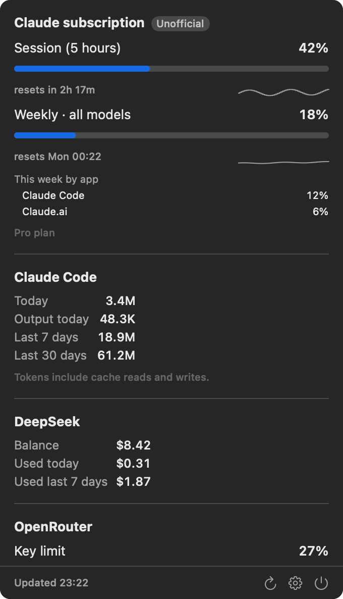
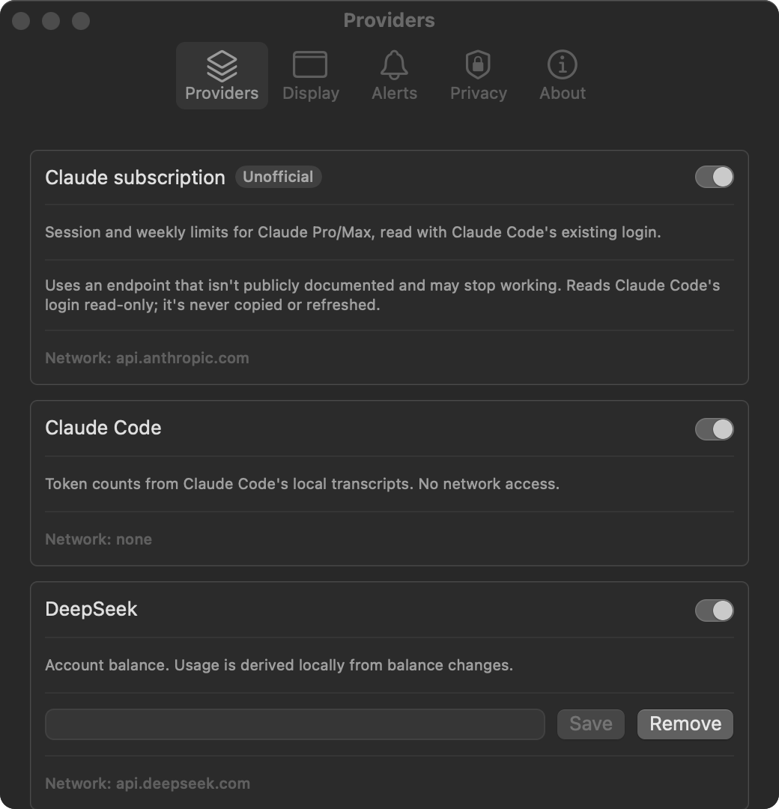
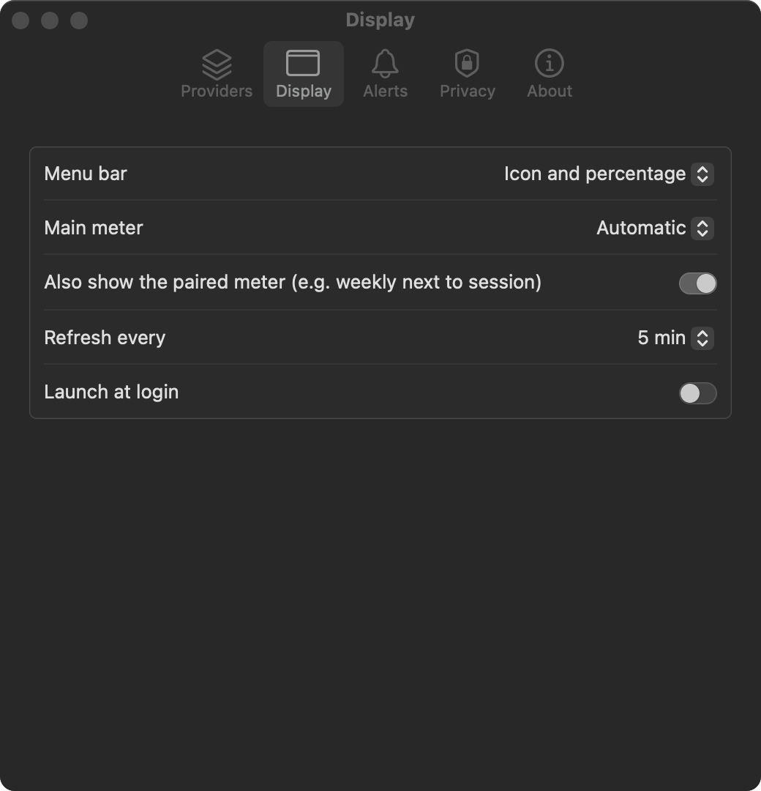
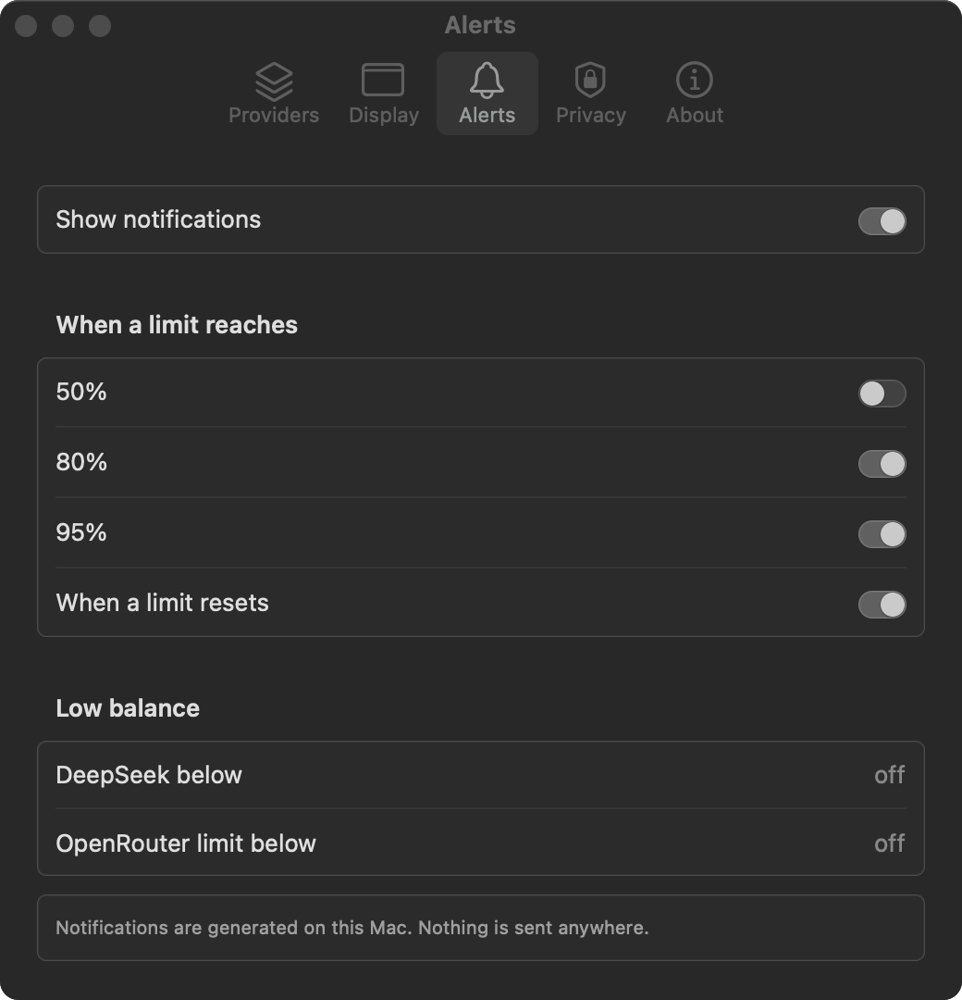
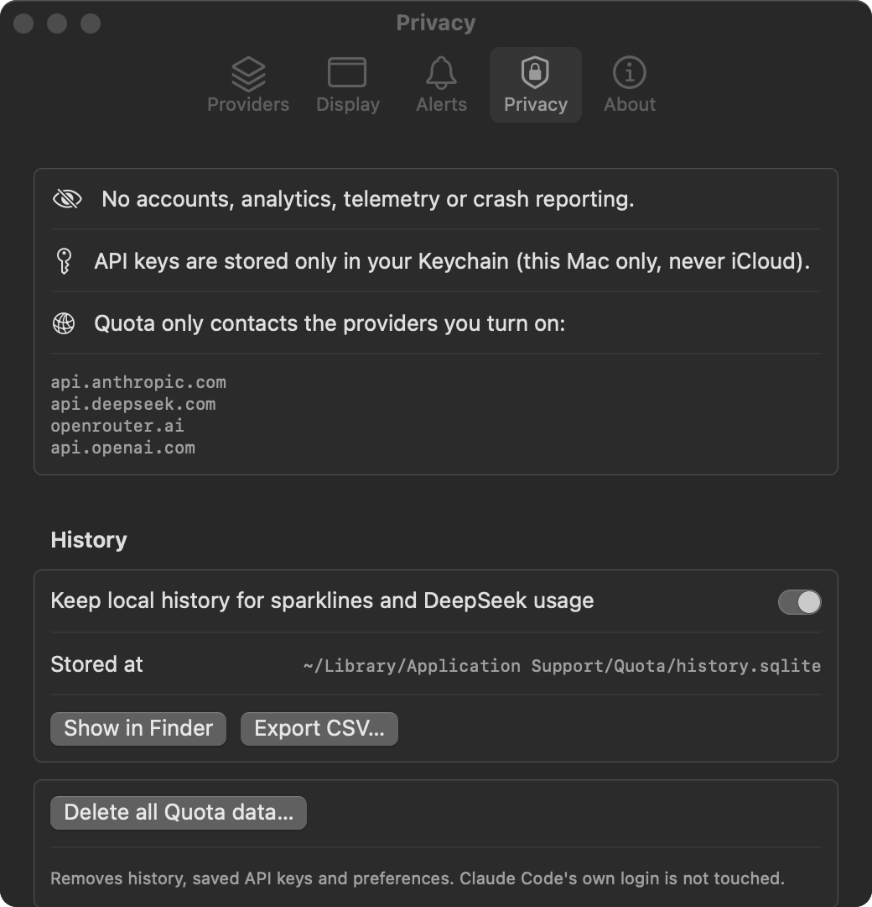

<h1 align="center">Quota</h1>

<p align="center"><strong>Know exactly how much AI you have left, right in your Mac's menu bar.</strong><br>
Claude limits, Claude Code tokens and API credits in one glance. Private by design: no accounts, no tracking, nothing leaves your Mac except the requests you turn on.</p>

<p align="center"></p>

<p align="center"></p>

<p align="center"><sub>Screenshots use made-up demo data.</sub></p>

---

## Why Quota

Hitting a Claude limit in the middle of a task is frustrating. Finding out your API credits ran dry is worse. Quota puts the numbers where you'll see them:

- **Claude Pro / Max:** your 5-hour session and weekly limits, with reset times. These are the same numbers as `/usage` in Claude Code.
- **Claude Code:** tokens used today, this week and this month, split by model.
- **DeepSeek, OpenRouter, OpenAI:** balances, spend and key limits.
- **Alerts:** an optional notification at 80% or 95%, when a limit resets, or when a balance runs low.
- **History:** small 7-day trend lines, stored only on your Mac.

## Built to be trusted

Quota sees your API keys and your Claude login, so it's built to deserve that access.

| Promise | How it's kept |
|---|---|
| **No tracking of any kind** | No analytics, telemetry, crash reporting, update checks or accounts. Quota has no third-party code at all, only Apple's frameworks. |
| **Talks only to the services you turn on** | Every provider starts **off**. Requests go to a fixed list of four API addresses. Any other address is refused in code, and redirects are never followed, so a key can't be bounced elsewhere. |
| **Your keys stay in your Keychain** | API keys are stored in the macOS Keychain, on this Mac only. They never sync to iCloud and are never written to files, logs or URLs. |
| **Your Claude login is only read** | Quota reads Claude Code's existing login without changing it. The login is never copied, refreshed or stored, and is only ever sent to `api.anthropic.com`. |
| **Your data stays yours** | History is a single file on your Mac that only your user account can open. You can turn it off, export it as CSV, or delete everything in one click. |
| **You can check all of this** | The code is open and small. Every commit runs an automated privacy check, and you can watch Quota's traffic with Little Snitch, LuLu or `nettop`. |

The full details are in [PRIVACY.md](PRIVACY.md). To report a security issue, see [SECURITY.md](SECURITY.md).

## Getting started

### 1. Install

You need macOS 14 Sonoma or later.

**Build from source (recommended).** This needs Xcode 16 or its command line tools (`xcode-select --install`).

```sh
git clone https://github.com/acdumitrescu/quota-bar.git
cd quota-bar
scripts/build-app.sh --install
```

This builds Quota, copies it to `~/Applications` and starts it. A gauge icon appears in your menu bar.

<details>
<summary><strong>Or download a ready-made build</strong></summary>

Builds on the [Releases](https://github.com/acdumitrescu/quota-bar/releases) page are signed ad hoc, not notarized. Notarizing needs an Apple Developer ID, which publishes the developer's legal name. So macOS will warn you the first time:

1. Unzip `Quota-x.y.z.zip` and move `Quota.app` to Applications.
2. Check the file against the SHA-256 checksum listed with the release: `shasum -a 256 Quota-x.y.z.zip`.
3. Right-click `Quota.app` → **Open** → **Open**. You only need to do this once.

</details>

### 2. Turn on your providers

Click the gauge icon, then the ⚙︎ button to open **Settings → Providers**. Switch on what you use:

<p align="center"></p>

| Provider | What you need |
|---|---|
| **Claude subscription** | Claude Code installed and logged in (`claude` in a terminal). Nothing to paste. |
| **Claude Code** | Nothing. Quota reads the token counts in `~/.claude/projects` and makes no network requests. |
| **DeepSeek** | An API key from [platform.deepseek.com](https://platform.deepseek.com/api_keys). |
| **OpenRouter** | An API key from [openrouter.ai/keys](https://openrouter.ai/keys). |
| **OpenAI** | An **Admin key** (`sk-admin-…`) from [platform.openai.com](https://platform.openai.com/settings/organization/admin-keys). Regular project keys can't read usage. |

Paste a key and click **Save**. It goes straight into your Keychain, and the field shows *Saved in Keychain* afterwards. Each provider lists the exact address it contacts.

### 3. Choose what the menu bar shows

In **Display**, pick the main meter (for example your Claude session), a ring or a percentage, and how often to refresh.

<p align="center"></p>

### 4. Get a heads-up before you run out (optional)

In **Alerts**, choose when to be notified. Notifications are created on your Mac. Nothing is sent anywhere.

<p align="center"></p>

### 5. Stay in control of your data

**Privacy** shows every address Quota may contact and where your history is stored. You can export or delete everything from here.

<p align="center"></p>

## Good to know

- **"Unofficial" Claude numbers.** The Claude subscription limits come from the endpoint Claude Code's `/usage` uses. Anthropic doesn't document it, so it may change. If your login expires, use Claude Code once and Quota picks it up again.
- **DeepSeek usage is estimated.** DeepSeek only reports your balance. Quota counts drops between refreshes as usage and ignores top-ups, so usage counts from when you turn it on.
- **"Rate limited (HTTP 429)".** The provider is asking clients to slow down. Quota retries on the next refresh. A refresh interval of 5 minutes or more avoids this.
- **Uninstall.** Use **Settings → Privacy → Delete all Quota data**, then move `Quota.app` to the Trash.

## Command line

`scripts/build-app.sh` also builds a `quota` command:

```sh
build/quota                    # Claude subscription, Claude Code, and any provider with a saved key
build/quota openrouter --json  # one provider, as JSON
```

It reads keys from the Keychain, or from `QUOTA_<PROVIDER>_KEY` environment variables (for example `QUOTA_OPENROUTER_KEY`).

## Development

```sh
swift test                 # parsers, history, allowlist and security tests (all fixtures are made-up data)
swift run QuotaApp         # run without bundling (notifications are off outside a .app)
scripts/privacy-check.sh   # run before every commit; CI runs it too
```

The code has three parts: `Sources/QuotaCore` (providers, Keychain, network allowlist, history; no UI), `Sources/QuotaApp` (the SwiftUI menu bar app) and `Sources/quota-cli`.

To regenerate the screenshots with demo data, run `build/Quota.app/Contents/MacOS/Quota --demo --shots docs/screenshots`. Demo mode makes no network requests and doesn't touch your Keychain, history or preferences.

Contributions are welcome. See [CONTRIBUTING.md](CONTRIBUTING.md).

## License

MIT. Not affiliated with Anthropic, DeepSeek, OpenRouter or OpenAI.
